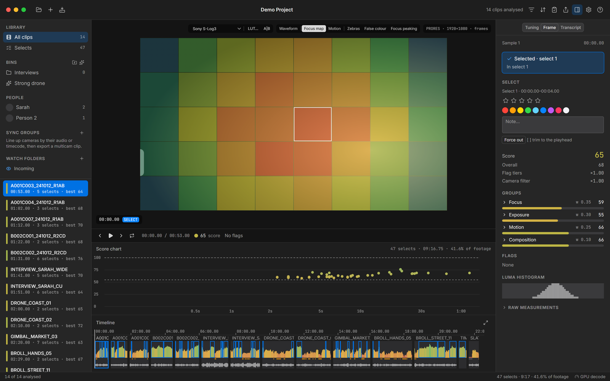
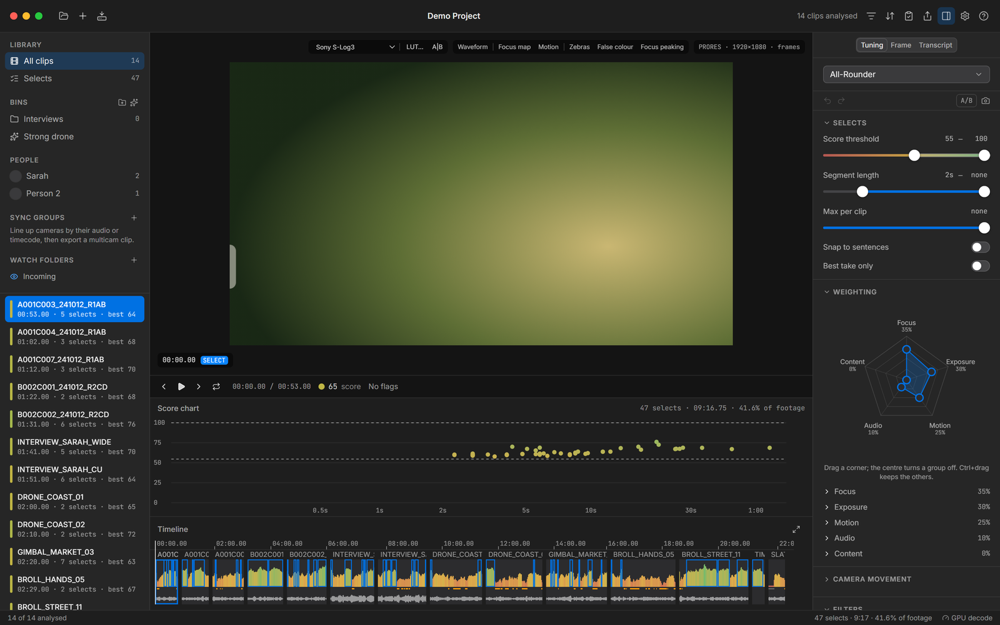
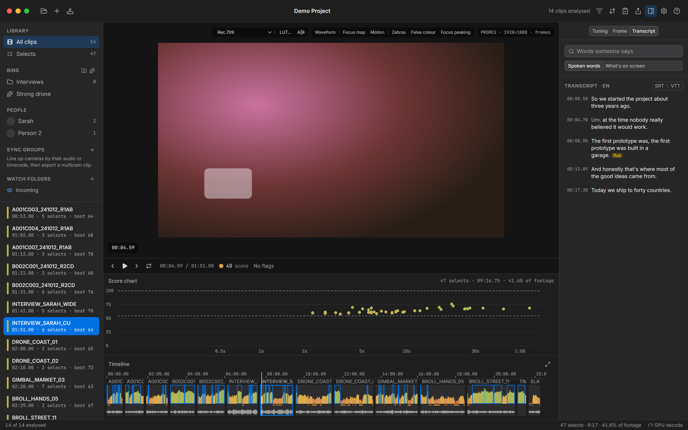
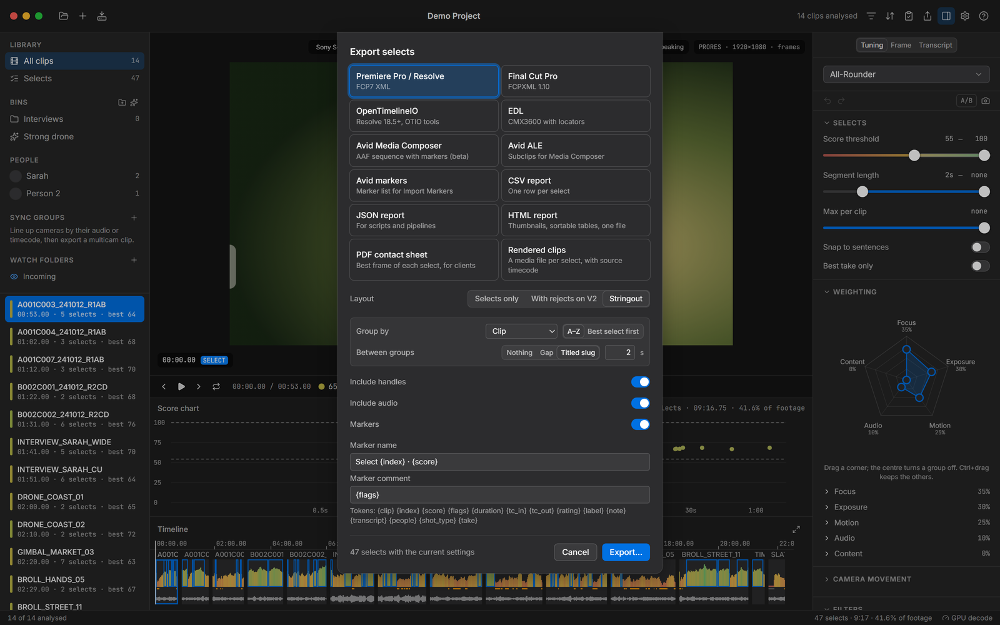
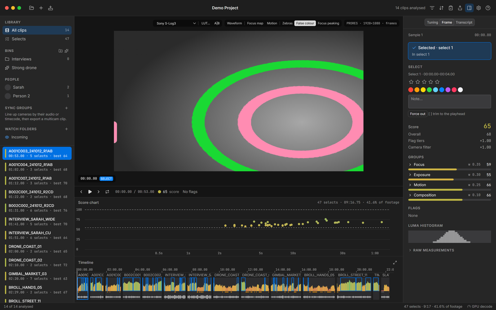

# ClipPro

**Finds the usable footage in a pile of clips.** ClipPro scores every second of your footage for focus, exposure, camera motion and sound, then hands Premiere Pro, DaVinci Resolve, Final Cut Pro or Avid a timeline of only the good parts. Optional local AI adds faces, shot types and searchable transcripts. Everything runs on your machine.



**[Download the latest version for Windows](https://github.com/OkataMiracleDev/ClipPro/releases/latest/download/ClipPro-setup-x64.exe)** · [All releases](https://github.com/OkataMiracleDev/ClipPro/releases) · Windows 10 / 11, 64-bit

## What it does

- **Measures** each clip in one decode pass: sharpness, detail and focus stability; exposure, flicker and grading headroom; camera and subject motion; loudness, clipping, wind, hum and speech.
- **Flags** what's unusable (blur, shake, clipping, low light, solid colour, bars, focus hunting, silence) and scores the rest against a preset you tune with sliders, a weighting radar and a camera-movement wheel.
- **Exports** the selects as a real timeline: FCP7 XML and FCPXML (Premiere, Resolve, Final Cut), AAF and ALE (Avid), OTIO and EDL, with markers that carry the scores. It can also read an edit back, score every shot and suggest better takes.
- **Handles the day-to-day work around the edit**: multicam sync, stringouts, proxies, rendered selects, and verified card offload with ASC MHL.
- **Local AI** (optional, off by default): face detection and People, shot types and visual search (CLIP), Whisper transcripts with filler and flub detection, speaker turns, sentence-aware selects and best-take filtering. Models download only after you turn it on.
- **Updates itself**: signed updates, offered at start-up with their release notes; nothing installs until you say so.

| | |
|---|---|
|  |  |
|  |  |

## Install

Download `ClipPro-setup-x64.exe` from the [latest release](https://github.com/OkataMiracleDev/ClipPro/releases/latest) and run it. It installs for your user only, so it needs no administrator rights. There is also a portable ZIP.

The installer isn't code-signed yet, so Windows SmartScreen may warn on first run: choose **More info → Run anyway**. Updates themselves are signed and verified before they install.

The in-app manual (Help, or F1) covers every feature.

## Build from source

ClipPro is Rust (core, analysis, FFmpeg decoding, ONNX Runtime and whisper.cpp for the AI models) with a React + TypeScript interface in [Tauri 2](https://tauri.app).

```powershell
powershell -File scripts\bootstrap.ps1 -AcceptMsvcLicense   # portable toolchain into third_party\ (no admin)
powershell -File scripts\doctor.ps1                         # checks everything is there
```

Then, in Git Bash:

```bash
source scripts/env.sh
cargo build --release -p clippro-testgen && ./target/release/clippro-testgen.exe --out testdata/gen --mini   # test footage
cargo test --workspace --release
cd app && ./ui/node_modules/.bin/tauri build      # the installer, in target/release/bundle
```

`scripts\verify.ps1` runs every check (clippy, UI type-check and tests, bindings drift, Rust tests, licences). With Visual Studio and LLVM already installed, `bootstrap.ps1 -Only ffmpeg,npm` is enough.

Design notes live in [docs/SPEC.md](docs/SPEC.md), [docs/ALGORITHMS.md](docs/ALGORITHMS.md) and [docs/decisions](docs/decisions). Releasing is described in [RELEASING.md](RELEASING.md).

## Licence

ClipPro is source-available under the [MIT licence with the Commons Clause](LICENSE), by Miracle Okata. You may use it for any work, including paid work, and modify and share it, keeping the copyright notice. You may not sell ClipPro itself, or a product or service whose value comes mainly from it.

FFmpeg (LGPL), ONNX Runtime, DirectML, whisper.cpp and the AI models keep their own licences; see `licenses/` in an installation and [docs/models.md](docs/models.md).
